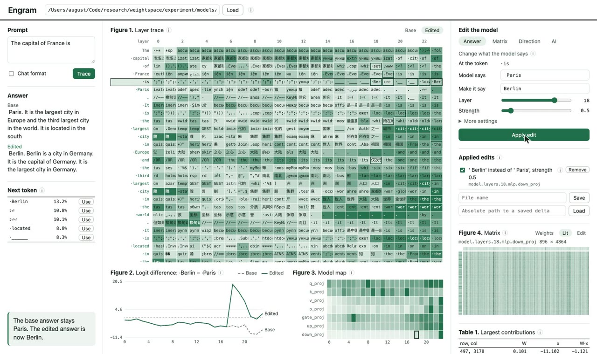

# Engram

<video src="docs/demo.mp4" poster="docs/demo.jpg" controls width="100%"></video>

[](docs/demo.mp4)

[Watch the demonstration (MP4)](docs/demo.mp4)

Engram is a local visual instrument for the inspection and direct editing of the weights of Hugging Face transformers. It computes no gradient and runs no training loop. Each edit is a closed-form change to named weight matrices, and each edit is reversible.

## 1. Method

For a prompt, Engram records the prediction of every layer at every token, the output of every weight matrix, and the input to the open matrix. An edit then changes one matrix $W$ in one of three ways.

| Operation | Definition |
| --- | --- |
| Rank-one write | $W' = W + \alpha\, u v^{\top}$ |
| Scale or clear | $W'_{ij} = c\, W_{ij}$ for the selected rows $i$ and columns $j$ |
| Direction removal | $W' = W - \lambda\, d d^{\top} W$ |

In the rank-one write, $u$ moves the output from the current token toward the wanted token. The vector $v$ is the input at a selected token, or the difference between the means of two groups of pinned tokens.

The interface has four figures and one table.

| Item | Content |
| --- | --- |
| Figure 1 | The top prediction of each layer at each token |
| Figure 2 | The logit difference between two tokens, by layer, before and after the edit |
| Figure 3 | The size of the output of each weight matrix |
| Figure 4 | The weights, the weights multiplied by their input, or the change |
| Table 1 | The entries that contribute most at the selected token |

## 2. Installation

Engram needs Python with `torch`, `transformers`, and `safetensors`. The AI tab also needs [Bun](https://bun.sh).

    pip install torch transformers safetensors
    cd ai && bun install && cd ..
    python server.py --model /path/to/a/local/model

Open http://127.0.0.1:7860. The server accepts requests from the local computer only.

## 3. Use

1. Enter a prompt and press Trace.
2. In the Answer tab, enter the word that the model must say.
3. Set the layer and the strength. Start with a small strength.
4. Press Apply edit, and compare the Base and Edited answers.

Clicking a row in Figure 1 inspects that token and does not move the edit. Each new Apply replaces the previous try. Applied edits can be turned off, removed, or saved as a `safetensors` delta in `exports/`. Write model writes a complete Hugging Face model folder to `exports/`, with the active edits built in and a record in `engram_edits.json`.

## 4. Edits written by an AI

The AI tab uses the [Vercel AI SDK](https://ai-sdk.dev). An AI chooses an edit, Engram applies it, and the AI reads the new answer and can try again. If "Apply edits" is cleared, the AI proposes one edit and does not apply it.

Ollama, LM Studio, and llama.cpp run on the local computer and need no key. Anthropic, OpenAI, OpenRouter, Groq, Together, DeepSeek, and any other compatible address are also available. A hosted provider receives the prompt, the tokens, and the predictions. Keys are stored in `~/.engram/credentials.json` with mode 0600, and the page cannot read them.

The AI loop has been tested only against a scripted stand-in server, in the OpenAI-compatible and Anthropic request formats.

## 5. Desktop application

The folder `electron/` builds a macOS application. The application starts `server.py` with a Python that you choose, and it stores the choice in `~/.engram/app.json`. Add the key `model` to that file to load a model when the application starts.

    cd ai && bun install && cd ../electron
    bun install && bun pm trust electron
    ./build.sh

The application is at `electron/build/Engram.app`.

## 6. Verification

`test_engine.py` checks the operations and exact rollback on Qwen2.5-0.5B-Instruct and on a tiny random GPT-2. It expects local model folders at `../experiment/models`. The `--paper` flag also needs the experiment code of the paper, which is not in this repository.

## 7. Related paper

The rank-one write in Engram is the edit that the paper below evaluates. On 200 held-out notes of a synthetic symptom-status task, one closed-form edit to Qwen2.5-1.5B-Instruct raised cell accuracy from 0.656 to 0.879.

> Abhinav Srivastava. *Can Weight-Space Programming Lead to Better Outputs in Medical AI?* Short paper submitted to the 11th International Workshop on Health Intelligence (W3PHIAI-27) at AAAI-27, under review.

```bibtex
@unpublished{srivastava2027weightspace,
  author = {Srivastava, Abhinav},
  title  = {Can Weight-Space Programming Lead to Better Outputs in Medical {AI}?},
  note   = {Short paper submitted to the 11th International Workshop on Health Intelligence (W3PHIAI-27) at AAAI-27, under review},
  year   = {2027}
}
```
